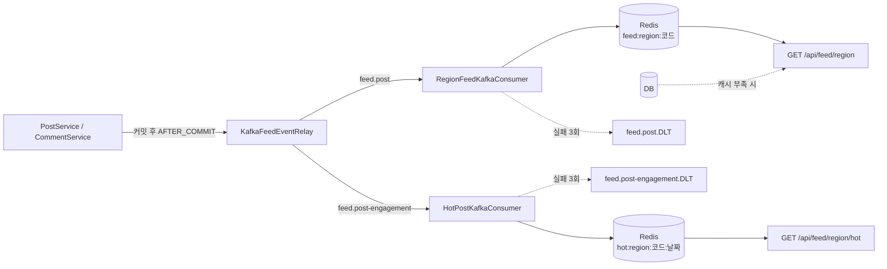

# 🐕 WithDog

반려견의 산책과 건강을 함께 관리하는 백엔드 서비스입니다.
산책 기록과 날씨·품종·지병을 고려한 코스 추천, 약/사료 사진 인식, 급여량 계산, 그리고 **같은 동네 사람들끼리의 커뮤니티 피드**를 제공합니다.

> 우리 개에게 맞는 산책을, 우리 동네 사람들과

<br>

## 주요 기능

### 🗺️ 산책
- 산책 시작/종료, 진행 중인 산책 조회, 산책 기록과 경로 조회
- 같은 사용자의 산책 중복 시작을 **비관적 락**으로 방지
- 주간 미션(횟수·거리·시간)과 경험치/레벨
  - 미션 달성 여부와 경험치 수령을 분리해, 사용자가 직접 수령해야 경험치가 지급됩니다

### 🤖 산책 코스 추천
- 강아지 품종·나이·체중, 현재 위치, 날씨(기상청)를 바탕으로 AI 서버에 코스 추천 요청
- 추천 결과를 규칙 기반으로 한 번 더 걸러냄
  - 소형견·노령견, 관절/심장/호흡기 질환·비만인 강아지는 긴 코스 제외
- Tmap 보행자 경로로 실제 걷는 경로 보정, 추천 결과는 Redis에 캐시

### 💊 건강 관리
- 약 봉투 사진 → OCR로 약 이름·용량·병원 추출 후 저장 (다른 병원 방문 시 공유용)
- 사료/간식 사진 → OCR로 제품명·칼로리 추출
- 체중 기반 하루 권장 칼로리(RER `70 × 체중^0.75`) 계산, 오늘 급여 기록과 배급량 조절 추천
- 강아지 지병 관리

### 👥 커뮤니티
- 게시글 작성/수정/삭제/검색, 이미지 첨부, **추천받은 산책 코스 공유**
- 좋아요, "내가 좋아요한 글" 모아보기
- 댓글과 대댓글(2단계), 알림
  - 댓글은 게시글 작성자에게, 대댓글은 원본 댓글 작성자에게 알림

### 🏘️ 동네 피드
- 프로필 좌표를 카카오 로컬 API로 **시군구 행정구역 코드**로 정규화
  - 게시글에는 작성 시점의 동네를 저장합니다. 산책 코스가 있으면 코스 시작점 기준입니다
- **동네 최신 글**: Redis Sorted Set 타임라인 + 커서 기반 페이징, 캐시가 비면 DB로 대체 조회
- **동네 인기글**: 좋아요 +1, 댓글 +2 점수를 일자별로 쌓고, 최근 3일을 날짜 가중치(1 / 0.5 / 0.25)로 합산
- 게시글·좋아요·댓글 이벤트를 **Kafka**로 발행하고 consumer가 피드를 갱신 (재시도 후 DLT, 중복 수신 방어)

<br>

## 기술 스택

| 구분 | 사용 기술 |
|---|---|
| Language | Java 21 |
| Framework | Spring Boot 4.1, Spring Security, Spring Data JPA, Bean Validation |
| Auth | JWT (jjwt) — Access Token + Redis에 저장하는 Refresh Token, 로그아웃 블랙리스트 |
| Database | H2 (인메모리) |
| Cache / Feed | Redis (Sorted Set, Lua 스크립트) |
| Messaging | Apache Kafka (Spring Kafka) |
| External API | 기상청 단기예보, Tmap 보행자 경로, 카카오 로컬(좌표→행정구역), AI 추천/OCR 서버 |
| HTTP Client | Spring WebClient (Reactor Netty 커넥션 풀) |
| Test | JUnit 5, Mockito, AssertJ, EmbeddedKafka |
| CI/CD | GitHub Actions → GHCR Docker 이미지 |
| Frontend | React 18 + Vite (`frontend/`, 기능 확인용) |

<br>

## 아키텍처

### 패키지 구조

기능(도메인) 단위로 패키지를 나누고, 각 도메인 안에서 계층을 나눕니다.

```
src/main/java/com/example/withdog/
├── auth/            # 회원가입, 로그인, 토큰 재발급, 로그아웃
├── user/            # 사용자 프로필
├── dog/             # 강아지 프로필, 지병
├── walk/            # 산책 기록
├── mission/         # 주간 미션, 경험치
├── recommend/       # 산책 코스 추천
├── route/           # Tmap 보행자 경로
├── weather/         # 기상청 날씨
├── medication/      # 약 봉투 OCR
├── diet/            # 사료/간식 OCR, 급여량
├── post/            # 게시글, 좋아요
├── comment/         # 댓글, 대댓글
├── notification/    # 알림
├── region/          # 좌표 → 시군구 정규화
├── feed/            # 동네 최신 글 / 인기글, Kafka producer·consumer
└── global/          # 보안, 예외 처리, 공통 설정, 파일 저장

<도메인>/
├── domain/          # 엔티티, 도메인 규칙, 도메인 이벤트
├── application/     # 서비스, DTO
├── infrastructure/  # Repository, 외부 API 클라이언트, 메시징
└── presentation/    # Controller
```

### 외부 연동

외부 API는 모두 인터페이스 뒤에 두고, 실제 구현체와 Mock 구현체를 프로필로 나눕니다.
로컬과 테스트(`local` 프로필)는 외부 서버 없이 전체 흐름을 실행할 수 있습니다.

| 인터페이스 | 실제 구현 (`!local`) | 로컬/테스트 (`local`) |
|---|---|---|
| `AiModelClient` | AI 서버 `/recommend` | `MockAiModelClient` |
| `OcrClient`, `FoodOcrClient` | AI 서버 `/ocr/*` | `MockOcrClient`, `MockFoodOcrClient` |
| `RouteClient` | Tmap 보행자 경로 | `MockRouteClient` |
| `RegionClient` | 카카오 `coord2regioncode` | `MockRegionClient` |
| `WeatherClient` | 기상청 단기예보 | — (실패 시 `unknown` 반환) |

모든 `WebClient`에는 커넥션 풀 상한과 응답 타임아웃을 둡니다. 외부 API가 느려져도 Tomcat 스레드가 무한정 쌓이지 않습니다.

### 동네 피드 흐름



- 이벤트는 **트랜잭션 커밋 이후에만** 발행합니다. 롤백된 글이 피드에 들어가지 않습니다.
- 최신 글 타임라인은 `ZADD`/`ZREM`이라 같은 메시지를 여러 번 처리해도 결과가 같습니다.
- 인기글 점수(`ZINCRBY`)는 그렇지 않아서, `eventId` 처리 기록과 점수 증가를 **Lua 스크립트 하나로 원자 실행**해 중복 반영을 막습니다.
- `feed.event.transport=direct`(기본값)로 두면 Kafka 없이 같은 프로세스 안에서 바로 Redis에 반영합니다.

<br>

## 시작하기

### 요구 사항
- JDK 21
- Docker (Redis, 선택적으로 Kafka)

### 1. 인프라 실행

Redis만 필요하면:
```bash
docker run -d --name with-dog-redis -p 6379:6379 redis:7-alpine
```

Kafka 경로까지 사용하려면 Redis와 Kafka를 함께 띄웁니다. 위 Redis 컨테이너와 6379 포트가 겹치므로 둘 중 하나만 사용하세요.
```bash
docker compose up -d
```

### 2. 설정 파일 작성

`src/main/resources/application.yml`은 개인 설정이라 Git에 포함되지 않습니다. 아래 내용으로 직접 만들어 주세요.
테스트용 설정 [`src/test/resources/application.yml`](src/test/resources/application.yml)을 복사해서 시작해도 됩니다.

```yaml
spring:
  profiles:
    active: local          # 외부 API 대신 Mock 구현체 사용
  data:
    redis:
      host: localhost
      port: 6379

jwt:
  secret: ${JWT_SECRET:로컬용-32바이트-이상의-임의-문자열}
  access-token-expiration: 3600000      # 1시간
  refresh-token-expiration: 1209600000  # 14일

ai:
  server:
    base-url: http://localhost:8000
weather:
  base-url: https://apis.data.go.kr/1360000/VilageFcstInfoService_2.0
  service-key: ${WEATHER_SERVICE_KEY:}
route:
  base-url: https://apis.openapi.sk.com
  app-key: ${TMAP_APP_KEY:}

file:
  upload-dir: ./uploads

feed:
  event:
    transport: direct      # Kafka를 쓰려면 kafka
```

### 3. 실행

```bash
./gradlew bootRun
```

서버는 `http://localhost:8080`에서 실행됩니다. 화면 없는 REST API 서버라 루트(`/`)는 404를 반환합니다.

화면으로 확인하려면 프론트엔드를 따로 실행합니다 (`http://localhost:5173`).
```bash
cd frontend && npm install && npm run dev
```

### 4. 테스트

테스트는 Redis가 필요합니다. Kafka 테스트는 JVM 안에서 임베디드 브로커를 띄우므로 Kafka는 따로 필요 없습니다.
```bash
./gradlew test
```

<br>

## 환경 변수

운영(`prod` 프로필, Docker 이미지 기본값)에서 사용하는 값입니다.

| 변수 | 설명 | 필수 |
|---|---|---|
| `JWT_SECRET` | JWT 서명 키 (32바이트 이상) | ✅ |
| `REDIS_HOST`, `REDIS_PORT` | Redis 주소 (기본 `localhost:6379`) | |
| `KAFKA_BOOTSTRAP_SERVERS` | Kafka 주소 (기본 `localhost:9092`) | |
| `FEED_EVENT_TRANSPORT` | `kafka`(기본) 또는 `direct` | |
| `AI_SERVER_BASE_URL` | AI 추천/OCR 서버 주소 | |
| `WEATHER_SERVICE_KEY` | 공공데이터포털 기상청 API 키 | |
| `TMAP_APP_KEY` | Tmap API 키 | |
| `KAKAO_REST_API_KEY` | 카카오 REST API 키 (좌표 → 행정구역) | |
| `FILE_UPLOAD_DIR` | 업로드 파일 저장 경로 (기본 `/app/uploads`) | |

<br>

## API

`/api/auth/signup`, `/api/auth/login`, `/api/auth/refresh`를 제외한 모든 API는 `Authorization: Bearer {accessToken}` 헤더가 필요합니다.

<details>
<summary><b>전체 엔드포인트 보기</b></summary>

| 도메인 | Method | Path | 설명 |
|---|---|---|---|
| Auth | POST | `/api/auth/signup` | 회원가입 |
| | POST | `/api/auth/login` | 로그인 |
| | POST | `/api/auth/refresh` | 토큰 재발급 |
| | POST | `/api/auth/logout` | 로그아웃 |
| User | GET | `/api/users/{id}` | 프로필 조회 (본인은 상세, 타인은 공개 정보) |
| | PUT | `/api/users/{id}` | 프로필 수정 (좌표 → 동네 정규화) |
| | POST | `/api/users/{id}/image` | 프로필 이미지 업로드 |
| Dog | POST | `/api/dogs` | 강아지 등록 |
| | GET | `/api/dogs`, `/api/dogs/{id}` | 목록 / 상세 |
| | PUT | `/api/dogs/{id}` | 수정 |
| | PATCH | `/api/dogs/{id}/health-conditions` | 지병 수정 |
| | POST | `/api/dogs/{id}/image` | 프로필 이미지 업로드 |
| | DELETE | `/api/dogs/{id}` | 삭제 |
| Walk | POST | `/api/walks` | 산책 시작 |
| | PUT | `/api/walks/{id}` | 산책 종료 |
| | GET | `/api/walks/ongoing` | 진행 중인 산책 |
| | GET | `/api/walks`, `/api/walks/{id}` | 산책 기록 목록 / 상세 |
| Mission | GET | `/api/missions/weekly` | 주간 미션 현황 |
| | POST | `/api/missions/weekly/{missionType}/claim` | 달성한 미션 경험치 수령 |
| Recommend | GET | `/api/dogs/{dogId}/recommend` | 산책 코스 추천 |
| Weather | GET | `/api/weather` | 현재 위치 날씨 |
| Medication | POST | `/api/dogs/{dogId}/medications/scan` | 약 봉투 사진 스캔 |
| | GET | `/api/dogs/{dogId}/medications`, `/{id}` | 복용 약 목록 / 상세 |
| | DELETE | `/api/dogs/{dogId}/medications/{id}` | 삭제 |
| Diet | GET | `/api/dogs/{dogId}/diet/recommendation` | 하루 권장 칼로리 |
| | POST | `/api/dogs/{dogId}/diet/foods/scan` | 사료/간식 사진 스캔 |
| | GET | `/api/dogs/{dogId}/diet/foods` | 사료/간식 목록 |
| | POST | `/api/dogs/{dogId}/diet/logs` | 급여 기록 |
| | GET | `/api/dogs/{dogId}/diet/summary/today` | 오늘 급여 요약 + 조절 추천 |
| Post | POST | `/api/posts` | 게시글 작성 (산책 코스 첨부 선택) |
| | GET | `/api/posts`, `/api/posts/{id}` | 검색 / 상세 |
| | PUT, DELETE | `/api/posts/{id}` | 수정 / 삭제 |
| | POST | `/api/posts/{id}/image` | 이미지 첨부 |
| | POST, DELETE | `/api/posts/{id}/like` | 좋아요 / 취소 |
| | GET | `/api/posts/liked` | 내가 좋아요한 글 |
| Comment | GET, POST | `/api/posts/{postId}/comments` | 댓글 목록 / 작성 (대댓글은 `parentId` 지정) |
| | PUT, DELETE | `/api/posts/{postId}/comments/{id}` | 수정 / 삭제 |
| Notification | GET | `/api/notifications` | 내 알림 목록 |
| | PATCH | `/api/notifications/{id}/read` | 읽음 처리 |
| Feed | GET | `/api/feed/region?cursor=&size=20` | 내 동네 최신 글 (커서 페이징) |
| | GET | `/api/feed/region/hot?size=10` | 내 동네 인기글 |

</details>

<br>

## CI/CD

[`.github/workflows/ci-cd.yml`](.github/workflows/ci-cd.yml)

- **Pull Request → `main`**: JDK 21 + Redis 서비스 컨테이너로 빌드와 테스트, 실패 시 테스트 리포트 업로드
- **Push → `main`**: 테스트 통과 후 Docker 이미지를 빌드해 `ghcr.io/shyuk113/with-dog`에 푸시 (`latest`, 커밋 SHA 태그)

```bash
docker run -p 8080:8080 -e JWT_SECRET=... -e REDIS_HOST=... ghcr.io/shyuk113/with-dog:latest
```

<br>

## 남은 과제

- 운영 DB를 H2 인메모리에서 MySQL/PostgreSQL로 전환 (현재는 재시작 시 데이터가 사라짐)
- 실제 서버 배포 단계 추가 (현재 CD는 GHCR 이미지 푸시까지)
- Kafka 발행 유실 방지를 위한 Transactional Outbox 패턴
- 로그인 시도 횟수 제한, 업로드 파일 접근 제어, 운영 CORS 도메인 제한

<br>

## 라이선스

[MIT](LICENSE)
